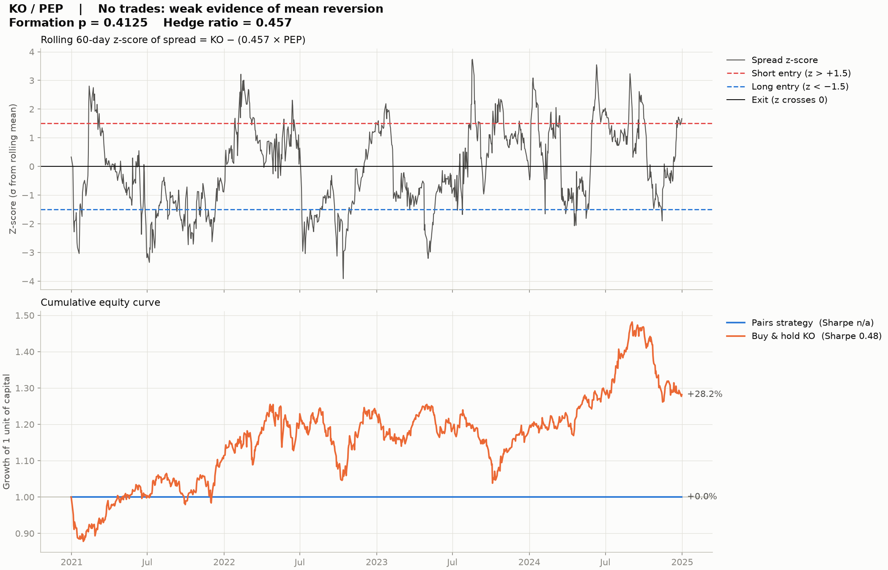

# Pairs Trading

Choose two stock tickers and test whether their historical prices support a long/short pairs strategy. Similar businesses can make a sensible pair to investigate. You can also compare companies from different industries. The program uses price history to decide whether to simulate trades.

## Run on this Windows computer

Double-click **Run Pairs Trading.cmd** in File Explorer. Enter the first and second Yahoo Finance tickers at the prompts. Press Enter at both prompts to try Coca-Cola (`KO`) and PepsiCo (`PEP`). The launcher uses the installed Python environment, prints the results, and opens the saved dashboard.

You can also run a specific pair from PowerShell in this folder.

```powershell
& ".\Run Pairs Trading.cmd" XOM CVX
```

Use the exchange suffix for overseas listings, such as `ULVR.L` or `7203.T`. Share classes use Yahoo's spelling, such as `BRK-B`. The first ticker is the benchmark and determines the currency for the backtest.

## Run in a separate Python installation

With Python 3.12, run these commands from the project folder. An internet connection is needed to download prices.

```shell
python -m venv .venv
```

On Windows, install the packages into that environment.

```powershell
.\.venv\Scripts\python -m pip install -r requirements.txt
.\.venv\Scripts\python pairs_trading.py KO PEP
```

On macOS or Linux, use `.venv/bin/python` for both commands. Run the script without ticker arguments in a terminal to choose the companies interactively.

## Dates and output

The default sample covers the five years before today. The start date is inclusive and the end date is exclusive. This command reproduces the date range in the original KO/PEP example.

```shell
python pairs_trading.py KO PEP --start 2020-01-01 --end 2025-01-01 --no-show
```

The program writes `pairs_KO_PEP.png` in the working directory. Each pair gets its own filename. Use `--output name.png` to keep a separate run for different dates, and `--no-show` to save without opening the image.

## How to read a run

1. **Common price dates.** The program takes split- and dividend-adjusted daily closes from Yahoo Finance. It converts the second stock to the first stock's currency when needed, using historical daily FX quotes. It keeps dates with prices for both stocks and the required exchange rate.
2. **Formation period.** The first 252 common closes are used for the Engle–Granger cointegration test and the OLS hedge ratio. Use `--formation-days` to change this window (minimum 60). At least three more common closes are needed for evaluation. Ticker order matters because the regression fits the first stock on the second.
3. **Pair decision.** A formation p-value below 0.05 and a positive hedge ratio enable the long/short simulation. If the pair misses either condition, the report gives the reason, shows zero trades, and still plots the spread and the first stock's buy-and-hold performance. A small p-value is historical evidence of a relationship. That relationship can change.
4. **Evaluation.** The hedge ratio stays fixed. The strategy tracks the spread (first price minus hedge ratio times second price). It buys the spread below a trailing 60-day z-score of −1.5, sells it short above +1.5, and exits when the score crosses zero. A decision at one close earns the following close-to-close return. The last close ends any remaining trade.
5. **Performance.** Equity starts at one unit of capital. The table reports total and annualized returns, annualized volatility, Sharpe ratio with a zero risk-free rate, and maximum drawdown. The benchmark holds the first stock over the same dates.

## Example from the original pair

For KO/PEP from January 2020 through December 2024, the first 252 closes produced a formation p-value of about **0.41**. The strategy stayed in cash for the evaluation period. This illustrates how two direct competitors can still fail the screen. Yahoo may revise adjusted historical prices.



The simulation assumes fills at the signal close, gross exposure of one unit per unit of capital, and zero interest on cash. Results exclude transaction costs, slippage, and short-borrow fees. For stocks on different exchanges, close times can differ even on a shared calendar date. Trying many combinations increases the chance that some will pass the screen by chance.
