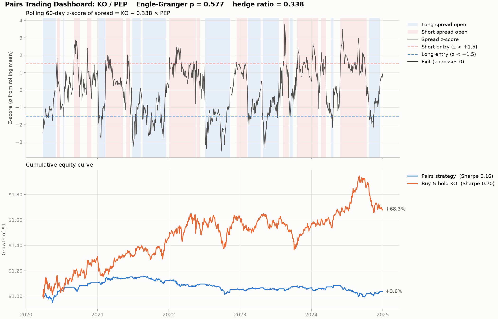

# Pairs-Trading
Python backtest of a statistical arbitrage pairs trading strategy on Coca-Cola (KO) vs PepsiCo (PEP): Engle-Granger cointegration test, OLS hedge ratio, rolling z-score entry/exit signals, and a performance dashboard.

# Pairs-Trading

Python backtest of a statistical arbitrage pairs trading strategy on Coca-Cola (KO) vs PepsiCo (PEP): Engle-Granger cointegration test, OLS hedge ratio, rolling z-score entry/exit signals, and a performance dashboard.



## Results (KO/PEP, daily data 2020–2024)

- **Cointegration:** the Engle-Granger p-value is 0.577, so the null hypothesis of no cointegration is not rejected. The pair is not statistically supported as mean-reverting over this sample.
- **Performance:** the strategy returned +3.6% (Sharpe 0.16) versus +68.3% (Sharpe 0.70) for buy-and-hold KO, before transaction costs.
- **Interpretation:** the spread often stayed far from its rolling mean for months, which is consistent with drift rather than reversion. The signal logic works as intended, but this pair does not satisfy the assumption the strategy relies on.

## How it works

1. **Data:** adjusted daily closes for both tickers from Yahoo Finance (`yfinance`), aligned on common trading days.
2. **Cointegration:** Engle-Granger two-step test (`statsmodels.tsa.stattools.coint`). The null hypothesis is that the pair is *not* cointegrated.
3. **Hedge ratio:** OLS regression of KO on PEP (with intercept). The slope β is the number of PEP shares that hedge one KO share, giving the spread `KO − β × PEP` (β = 0.338 here).
4. **Signal:** rolling 60-day z-score of the spread.
   - Long the spread (buy KO, sell PEP) when z < −1.5
   - Short the spread (sell KO, buy PEP) when z > +1.5
   - Close the trade when z crosses back over 0
5. **Backtest:** positions are decided at the close of day *t* and earn returns from day *t+1*, so the signal has no look-ahead. Each leg is weighted by its share of gross exposure.
6. **Metrics:** total return, annualised return, annualised volatility, Sharpe ratio (risk-free rate = 0) and max drawdown, compared against buy-and-hold KO.

## Run it

```bash
pip install -r requirements.txt
python pairs_trading.py
```

This prints the cointegration test, hedge ratio, trade count and performance table, and saves `pairs_trading_dashboard.png`.

## Configuration

All parameters sit at the top of `pairs_trading.py`:

| Parameter | Default | Meaning |
|---|---|---|
| `TICKER_A`, `TICKER_B` | `KO`, `PEP` | The pair (A is regressed on B) |
| `START_DATE`, `END_DATE` | 2020-01-01, 2025-01-01 | Sample period |
| `WINDOW` | 60 | Rolling window (trading days) for z-score mean and std |
| `ENTRY_Z` | 1.5 | Open a trade when \|z\| exceeds this |
| `EXIT_Z` | 0.0 | Close the trade when z crosses this level |
| `ALPHA` | 0.05 | Significance level for the cointegration test |

## Limitations

- **In-sample hedge ratio.** The cointegration test and the OLS hedge ratio are fitted on the full sample, so the parameters use information from the future. A stricter test would fit them on a training window (or use a rolling regression) and evaluate out of sample.
- **No trading frictions.** The backtest ignores transaction costs, slippage and short-borrow fees.
- **Untuned parameters, one pair.** The window and thresholds are not optimised or validated out of sample, and results from a single pair over one period should not be generalised.

## Possible extensions

- Scan a universe of candidate pairs and keep only those that pass the cointegration test
- Fit the hedge ratio on a training window and report out-of-sample results
- Add transaction costs and a rolling hedge ratio

## Disclaimer

This project is for educational purposes only and is not investment advice.
